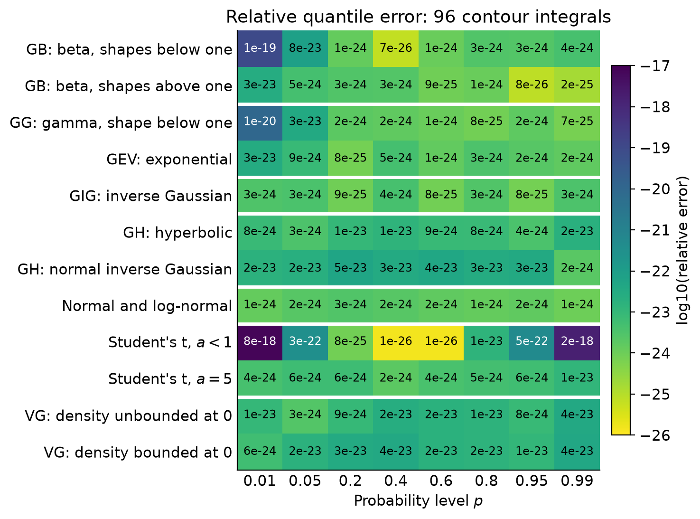
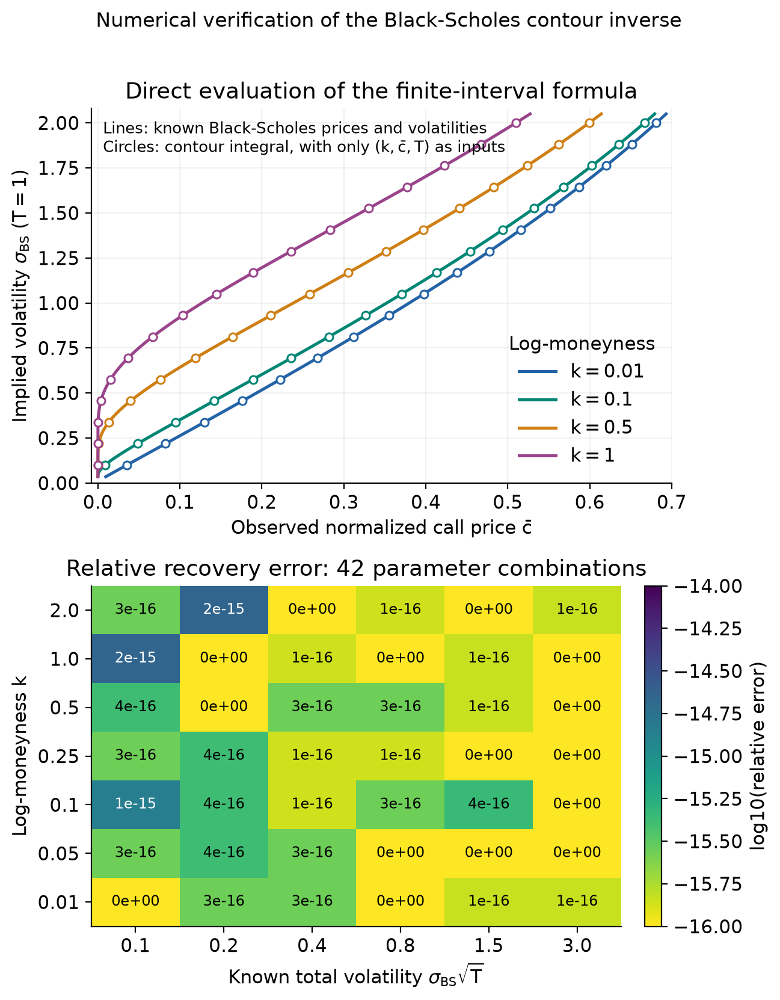

# Numerical tests

Code and results for Appendix D of the [working paper](../paper/working_paper_v1.pdf). Each test evaluates the contour integrals directly and compares them with independently computed reference values. The comparisons measure agreement on these test sets; they are not uniform quadrature error bounds. Equation and appendix numbers refer to the working paper.

| Folder | Paper | What it does |
| --- | --- | --- |
| [`distribution_quantiles/`](distribution_quantiles) | Appendix D.1, Figure D.1 | Quantile integrals for twelve working laws at eight probability levels |
| [`implied_volatility/`](implied_volatility) | Appendix D.2, Figure D.2 | The Black-Scholes implied-volatility integral, Eq. (25) |

Each folder holds the scripts together with the results and figures they produce.

## Reproducing the results

Python 3.12 was used. The pinned versions in `requirements.txt`, in the repository root, are the ones that produced the stored results. From the root:

```bash
pip install -r requirements.txt
```

**Distribution quantiles** (about 12 minutes on 8 cores):

```bash
cd numerical_tests/distribution_quantiles
python quantile_accuracy_table.py
python plot_heatmap.py
```

To recompute only some rows, pass their 0-based indices, for example `python quantile_accuracy_table.py 4 10 11`. A partial run keeps the other rows of the existing `results.json`.

**Black-Scholes implied volatility** (a few minutes):

```bash
cd numerical_tests/implied_volatility
python verify_implied_volatility.py
```

`--smoke` runs four quick cases, and `--skip-mp` skips the 35- and 50-digit checks.

## Distribution quantiles

The script evaluates the density form of the quantile integral, Eq. (4), with the contour heights of Section 3. Student's t uses the arctangent observable, Eq. (A.21), and the variance-gamma law uses the half-axis representation of Theorem A.2.

| Family | Working law | Parameters |
| --- | --- | --- |
| Generalized beta | Beta | (a, b) = (0.3, 0.6) and (2.5, 3) |
| Generalized gamma, GEV | Gamma | a = 0.4 and a = 1 (exponential, the GEV working law) |
| Generalized inverse Gaussian | Inverse Gaussian | (a, b) = (-1/2, 1) |
| Generalized hyperbolic | Hyperbolic, normal inverse Gaussian | (a, b, d) = (1, 1.5, 0.5) and (-1/2, 2, 1) |
| Normal, log-normal | Standard normal | |
| Student's t | Student's t | a = 1/2 and a = 5 |
| Variance gamma | Variance gamma | (a, d) = (-0.3, 0.15) and (1.5, 0.2) |

**Method.**

- Each integral uses composite 20-point Gauss-Legendre quadrature in 24-digit arithmetic (mpmath). Each law uses one fixed mesh for all eight probability levels.
- Cells lie in a logistic, logarithmic, or linear coordinate and are no wider than the contour height in that coordinate, except in the far Student tails beyond all tested quantiles.
- Where no closed-form complex CDF is available (GIG, GH, VG), the CDF is accumulated along the contour with the matching Gauss-Legendre integration matrix.
- Reference quantiles solve the real equation P(x) = p by Newton's method in 30-digit arithmetic, starting from double-precision SciPy values. Reference CDFs use closed forms for beta, gamma, normal, and Student's t, and double-exponential quadrature of the real density for GIG, GH, and VG.

**Results.** All 96 relative errors are below 10<sup>-17</sup>, and 86 of them lie between 10<sup>-25</sup> and 10<sup>-22</sup>. The largest values reflect finite working precision. At the smallest quantiles, contributions of order one cancel, and for Student's t with a = 1/2 at p = 0.01 and 0.99 the tangent reconstruction amplifies errors by about |Q| = 10<sup>3</sup>.

As controls, the accumulated CDFs reach their total masses to about 10<sup>-24</sup>, and the numerically integrated reference densities integrate to one within 10<sup>-30</sup>. The numerically integrated VG mass below zero agrees with the closed-form p<sub>0</sub> within 10<sup>-30</sup>.



## Black-Scholes implied volatility

Call prices are generated from known volatilities at 100 decimal digits. The integral evaluator then receives only the log-moneyness k, the observed normalized price c&#772;, and the maturity T, and recovers the volatility by quadrature, without root finding. The grid has 42 combinations of k in {0.01, 0.05, 0.1, 0.25, 0.5, 1, 2} and total volatility in {0.1, 0.2, 0.4, 0.8, 1.5, 3}, with prices from 3.72 x 10<sup>-91</sup> to 0.866.

| Check | Largest error |
| --- | --- |
| Absolute volatility error, 42-case grid | 1.33 x 10<sup>-15</sup> |
| Relative volatility error, 42-case grid | 2.22 x 10<sup>-15</sup> |
| Absolute repricing error, 42-case grid | 2.22 x 10<sup>-16</sup> |
| Relative volatility error, 68 plotted points at T = 1 | 2.22 x 10<sup>-15</sup> |
| Relative error, independent mpmath check at 35 digits | 8.41 x 10<sup>-32</sup> |
| Relative error, independent mpmath check at 50 digits | 1.67 x 10<sup>-51</sup> |

The exact argument of the logarithm lies in the upper half-plane and approaches the negative real axis as t tends to 0. There, rounding can flip the sign of its tiny imaginary part. Both evaluators therefore keep the upper-half-plane limit, with argument +pi. Without this safeguard the integral can return a wrong value.


